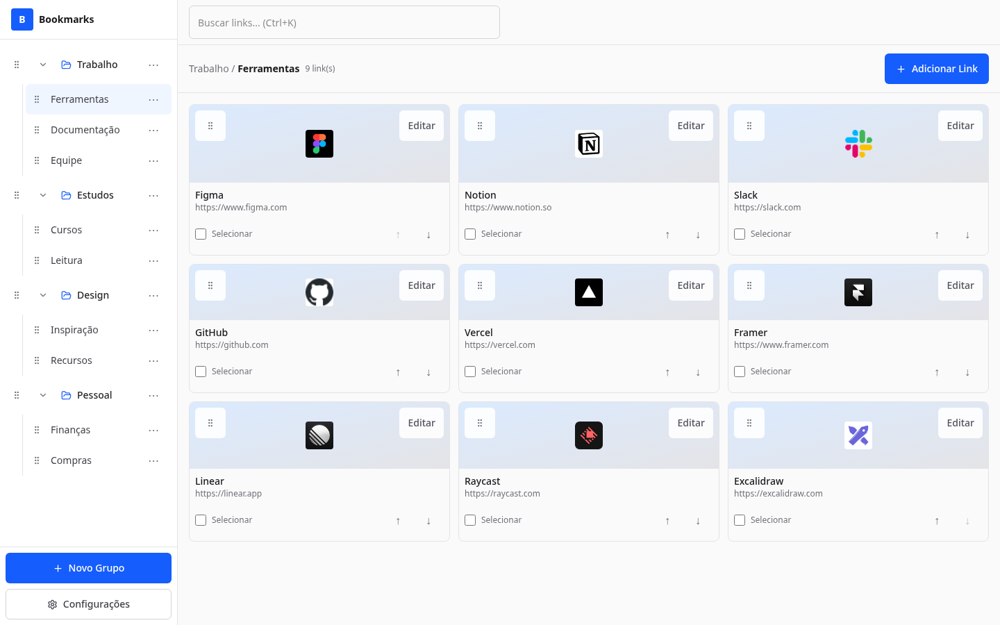
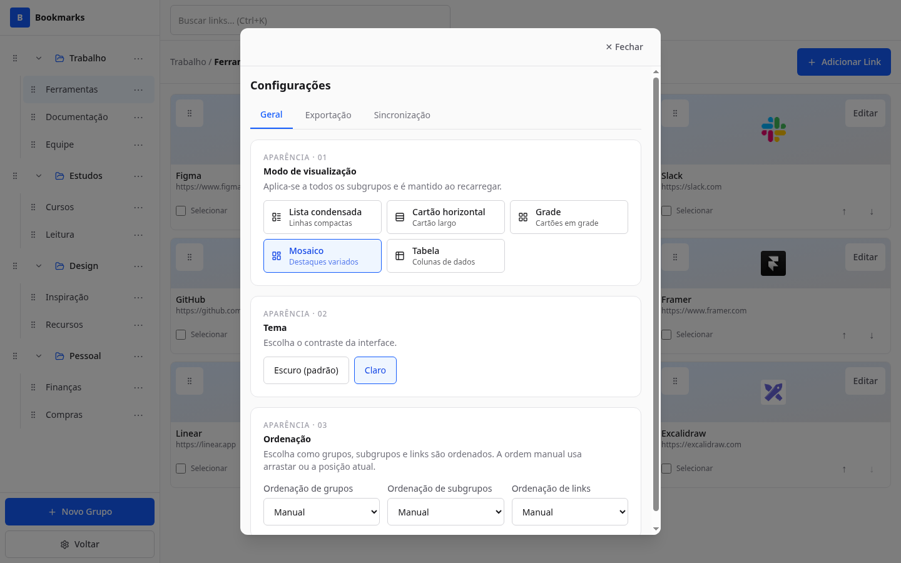
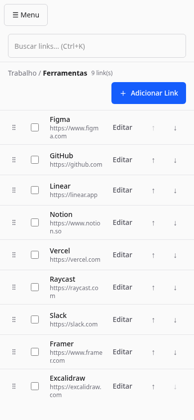

# 🔖 Bookmarks

**Todos os seus links favoritos, organizados e só seus.**

Um gerenciador de bookmarks que vive no seu navegador. Rápido, privado e sem cadastro — porque seus favoritos não precisam de uma conta na nuvem.

### 👉 [bookmarks.densyy.com](https://bookmarks.densyy.com)

## Organização que faz sentido

Grupos, subgrupos e links. Simples assim:

`Trabalho → Ferramentas → figma.com`

Nada de pilha infinita de favoritos. Cada link tem um lugar — e você acha tudo em segundos.

## Por que você vai gostar

- **Privacidade de verdade** — nenhum dado sai da sua máquina. Sem login, servidor ou rastreamento.
- **Busca instantânea** — aperte `Ctrl+K` e encontre qualquer link na hora.
- **Do seu jeito** — 5 modos de visualização, temas claro e escuro. No celular vira lista automaticamente.
- **Arrasta e solta** — reordene grupos, subgrupos e links; a ordem fica salva.
- **Backup fácil** — exporte tudo em um arquivo JSON e importe quando quiser.
- **Sincronização opcional** — envie seu backup para o Bunny Storage e restaure em outro dispositivo.

## Telas

### Configurações

### No celular

## Comece agora

1. Abra **[bookmarks.densyy.com](https://bookmarks.densyy.com)**.
2. Crie seu primeiro grupo.
3. Adicione subgrupos e links.
4. Pronto: tudo fica salvo no navegador.

> Dica: use `Ctrl+K` para buscar e experimente os 5 modos de visualização nas Configurações.

## Tecnologia

Feito com **Svelte 5 + SvelteKit**, **Tailwind CSS 4** e **IndexedDB (Dexie)**. Site 100% estático, sem backend.
